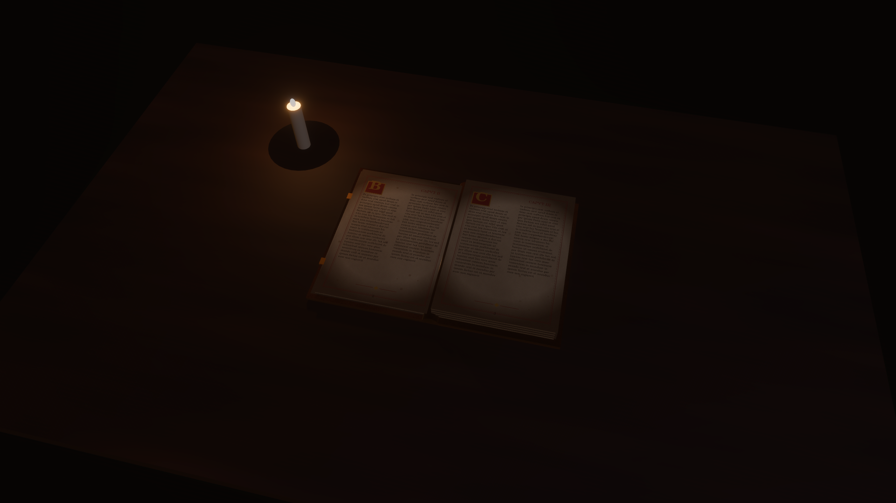

# Book 3D

An ancient tome (Rust + [Bevy](https://bevyengine.org) 0.20): thick leather boards with gold
ornaments, a page block, and 10 aged parchment pages you turn with the mouse, lit by a candle.



## Run

```sh
cargo run                      # first build of Bevy takes a few minutes
cargo test                     # physics and deformation unit tests
./scripts/generate-pages.sh    # regenerate pages and textures (ImageMagick)
BOOK3D_SCREENSHOT=docs/screenshot.png cargo run   # open the cover, save a frame, quit
```

Controls: **left-drag** the cover or a page to turn it (right half = forward, left half = back),
**right-drag** to orbit, **wheel** to zoom.

## Structure

```
assets/pages/        page-01.png … page-10.png (generated parchment)
assets/textures/     leather (+normal, roughness), wood, page edge, endpaper
src/main.rs          app + plugins
src/constants.rs     page count, sizes, physics and camera parameters
src/types.rs         components, resources and data types
src/scene/           camera (HDR, tone mapping, bloom), desk + candle, orbit, screenshot mode
src/book/            cover + ornaments, materials, page block, page mesh, bend deformation
src/physics/         page simulation (pure step function + tests)
src/input/           picking and pointer drag
```

## How the physics works

Each leaf (sheet, two pages) is a hinge at the spine with an angle (0 = right, π = left)
and an angular velocity. While held, a damped spring pulls the angle toward the point
under the cursor; on release only gravity (`-g·cos θ`, so it falls to the side it
leans toward) and air damping act, so position *and* release speed decide whether
the page completes the turn or falls back. Integration is semi-implicit Euler in fixed
1/240 s sub-steps with a clamped frame time, so it is frame-rate independent.

The paper bend lags behind the angle in proportion to the speed, plus a little sag
when lifted; rows far from the grab point bend more, which curls the corner. The page
mesh (32×12 grid) is rebuilt by walking along each row segment by segment, so the
paper keeps its length while it bends.

The front cover uses the same simulation with heavier parameters (`COVER_PHYSICS`: weaker
spring, more damping, no bend) and rotates as a rigid board. The page block is two slabs whose
thickness follows how many leaves have been turned.
